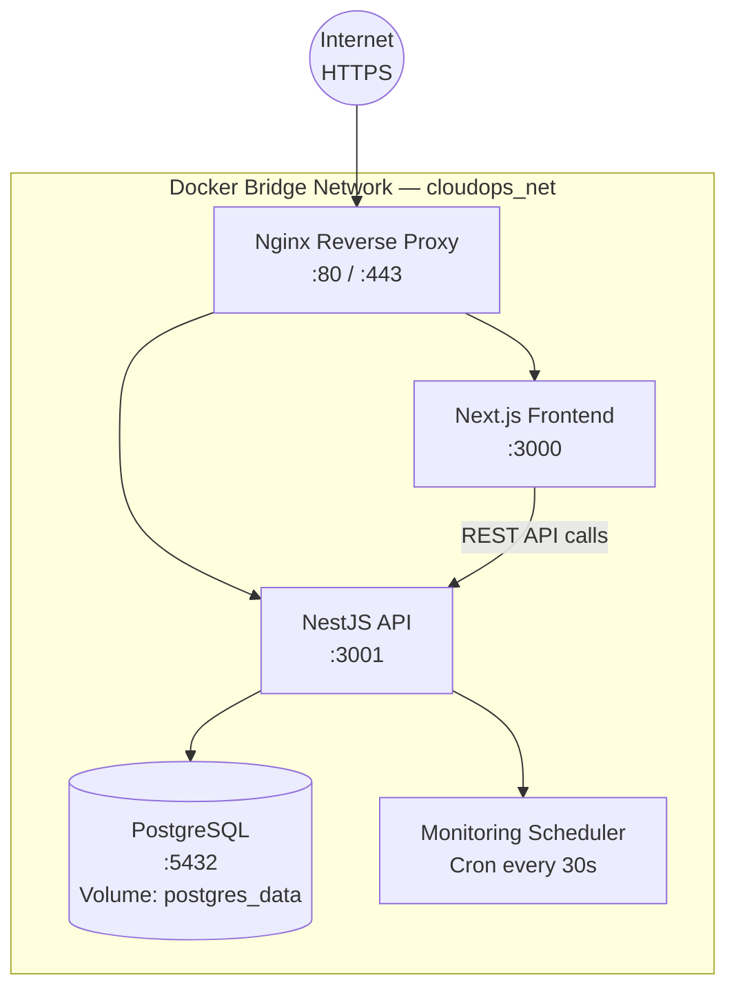

# CloudOps Manager

**Centralized infrastructure management for modern ops teams.**


---

## Overview

Operations teams managing multi-server infrastructure often rely on a fragmented set of tools — separate dashboards for server inventory, deployment tracking, metric collection, and incident response. Context switching between these tools slows incident detection and makes it difficult to maintain a coherent picture of the infrastructure's health.

CloudOps Manager is a unified web platform that brings projects, servers, deployed applications, monitoring metrics, and operational alerts into a single interface. It is role-aware (Admin, DevOps, Viewer), containerized for easy deployment on any VPS or cloud VM, and built entirely on a modern TypeScript stack.

---

## Key Features

- 🔐 **Authentication & RBAC** — JWT-based auth with Admin / DevOps / Viewer roles and server-side permission enforcement
- 📁 **Project Management** — Organize servers and applications by project and environment (Development / Staging / Production)
- 🖥 **Server Inventory** — Track VPS/VM specs (CPU, RAM, storage, IP), provider, region, and lifecycle status
- 📊 **Monitoring** — Simulated CPU / RAM / disk / network metrics with history charts and server availability tracking
- 🚀 **Application Tracking** — Deployment status, version management, and server association per application
- 🔔 **Alerting** — Configurable metric thresholds with severity levels (INFO / WARNING / CRITICAL) and incident history
- 🏠 **Dashboard** — Real-time global overview with counters, status summaries, and metric charts (30s auto-refresh)
- 🐳 **Containerized Deployment** — Full Docker Compose setup for development and production on any VPS or cloud instance

---

## Tech Stack

| Layer | Technology | Purpose |
|-------|-----------|---------|
| Frontend | Next.js 14 (App Router), TypeScript | Responsive web UI with server-side rendering |
| Backend | NestJS 10, TypeScript, REST | Modular API with Swagger/OpenAPI documentation |
| Database | PostgreSQL 16 | Primary relational data store |
| ORM | Prisma | Type-safe database client and schema migrations |
| Security | JWT, NestJS Guards, bcrypt | Authentication, RBAC, input validation |
| Infrastructure | Docker, Docker Compose, Nginx | Containerized deployment, SSL termination |
| Testing | Jest, Supertest | Unit and integration tests |

---

## Architecture Overview



> Full C4 diagrams and architecture details are in [docs/03-architecture](./docs/03-architecture/).

---

## Repository Structure

```
CloudOps Manager/
├── apps/
│   ├── backend/          ← NestJS API (Phase 2+)
│   └── frontend/         ← Next.js application (Phase 4+)
├── infra/
│   └── docker/           ← Dockerfiles & Compose (Phase 7)
├── docs/
│   ├── 01-requirements/  ← Vision, functional/non-functional requirements, user stories
│   ├── 02-uml/           ← Use case, class, sequence, activity, state diagrams
│   ├── 03-architecture/  ← C4 diagrams, deployment, security, coding standards
│   ├── 04-data-model/    ← ER diagram, data dictionary
│   ├── adr/              ← Architecture Decision Records (ADR-001 to ADR-006)
│   └── api/              ← REST endpoint catalog
├── .github/
│   ├── ISSUE_TEMPLATE/   ← Bug report and feature request templates
│   └── PULL_REQUEST_TEMPLATE.md
├── .editorconfig
├── .env.example
├── .gitattributes
├── .gitignore
├── CHANGELOG.md
├── CODE_OF_CONDUCT.md
├── CONTRIBUTING.md
└── LICENSE
```

---

## Roles & Permissions

| Action | Admin | DevOps | Viewer |
|--------|-------|--------|--------|
| Manage users | ✅ | ❌ | ❌ |
| Create / delete projects | ✅ | ✅ | ❌ |
| Register / delete servers | ✅ | ✅ | ❌ |
| Deploy applications | ✅ | ✅ | ❌ |
| Configure alert rules | ✅ | ✅ | ❌ |
| Acknowledge alerts | ✅ | ✅ | ❌ |
| View dashboard & metrics | ✅ | ✅ | ✅ (read-only) |
| View servers & apps | ✅ | ✅ | ✅ (read-only) |

Full permissions matrix: [docs/01-requirements/roles-permissions-matrix.md](./docs/01-requirements/roles-permissions-matrix.md)

---

## Project Roadmap

| Phase | Week | Deliverables | Status |
|-------|------|-------------|--------|
| **Phase 1** | 1 | Requirements, UML diagrams, architecture docs, ADRs, repository setup | 🟢 In Progress |
| **Phase 2** | 2 | NestJS project init, Prisma schema, DB entities, migrations | 🔵 Planned |
| **Phase 3** | 3 | Auth module (JWT + RBAC), Users module, Swagger setup | 🔵 Planned |
| **Phase 4** | 4 | Next.js project init, login UI, dashboard shell, API integration | 🔵 Planned |
| **Phase 5** | 5 | Servers, Applications, Projects modules (backend + frontend) | 🔵 Planned |
| **Phase 6** | 6 | Monitoring scheduler, metrics API, alerts module, dashboard charts | 🔵 Planned |
| **Phase 7** | 7 | Dockerfiles, Docker Compose, Nginx, environment configs, deployment | 🔵 Planned |
| **Phase 8** | 8 | Tests, CI pipeline, performance review, final documentation | 🔵 Planned |

---

## Getting Started

> ⚙️ **Setup instructions will be available from Phase 2 (backend scaffolding) and Phase 7 (Docker deployment).**

**Prerequisites** (for reference):

- [Node.js 20+](https://nodejs.org/)
- [Docker](https://www.docker.com/) and Docker Compose v2
- [PostgreSQL 16](https://www.postgresql.org/) (or use the provided Docker Compose service)

---

## Contributing

All contributions follow the branching strategy and commit conventions described in [CONTRIBUTING.md](./CONTRIBUTING.md).
Notable changes per release are tracked in [CHANGELOG.md](./CHANGELOG.md).

---


