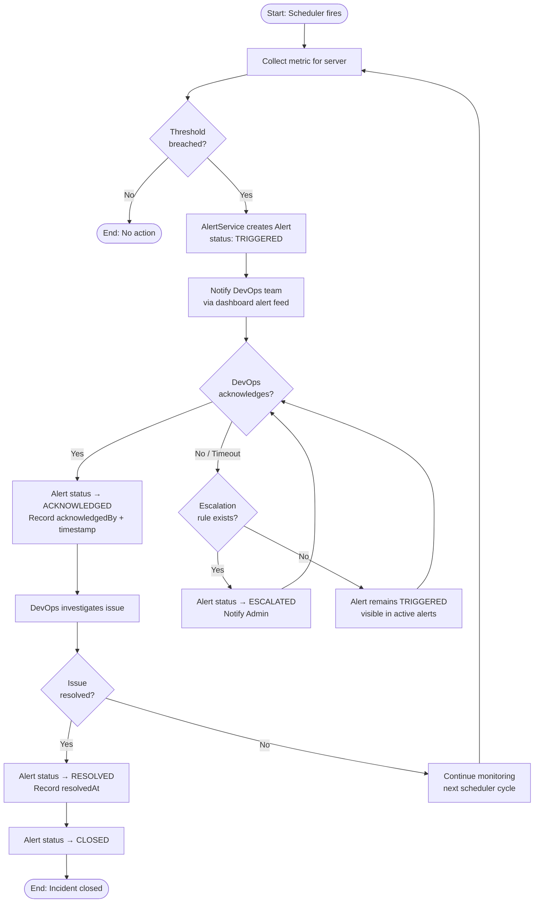

# Activity Diagram — Alert Lifecycle

Full flow from metric evaluation through alert creation, acknowledgement, escalation, and resolution.

## State Transitions Summary

| From | To | Trigger |
|------|----|---------|
| — | TRIGGERED | Metric breaches alert rule threshold |
| TRIGGERED | ACKNOWLEDGED | DevOps or Admin acknowledges the alert |
| TRIGGERED | ESCALATED | No acknowledgement within escalation timeout |
| ESCALATED | ACKNOWLEDGED | DevOps or Admin acknowledges the escalated alert |
| ACKNOWLEDGED | RESOLVED | DevOps marks the underlying issue as resolved |
| RESOLVED | CLOSED | System or Admin closes the resolved alert |
