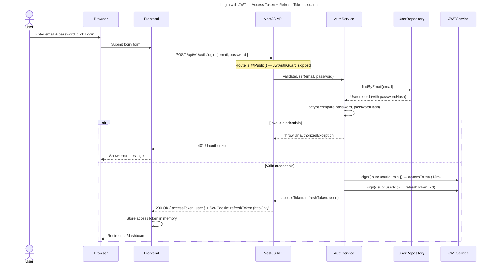
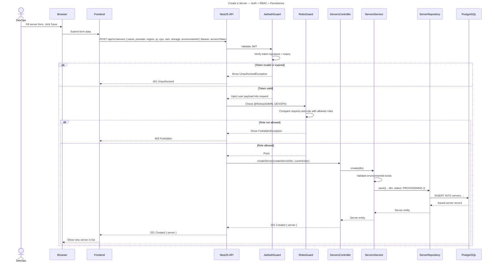
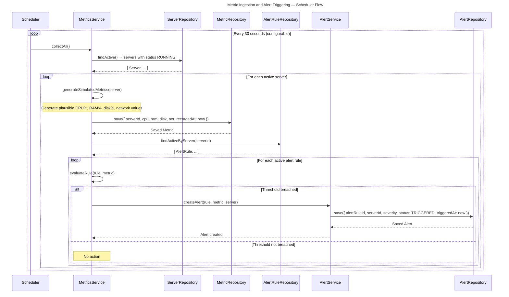
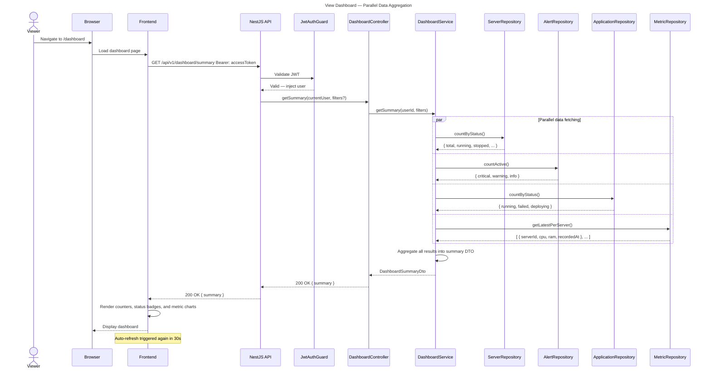

# Sequence Diagrams

Four key interaction flows in CloudOps Manager.

---

## 1. Login with JWT

---

## 2. Create a Server

---

## 3. Metric Ingestion and Alert Triggering

---

## 4. View Dashboard

