# Use Case Diagram

Use cases are represented as a directed graph grouped by actor. Arrows show which actor can perform which use cases.

```mermaid
flowchart TD
    subgraph Actors
        A([Admin])
        D([DevOps])
        V([Viewer])
        S([System Scheduler])
    end

    subgraph UC_AUTH["Authentication & Users"]
        UC1[Login]
        UC2[Refresh Token]
        UC3[Logout]
        UC4[View Own Profile]
        UC5[Update Own Profile]
        UC6[Create User Account]
        UC7[Assign Role to User]
        UC8[Deactivate User Account]
    end

    subgraph UC_PRJ["Projects"]
        UC9[Create Project]
        UC10[View Projects]
        UC11[Update Project]
        UC12[Delete Project]
        UC13[Assign Team Members]
        UC14[Manage Environments]
    end

    subgraph UC_SRV["Servers"]
        UC15[Register Server]
        UC16[View Server List]
        UC17[View Server Details]
        UC18[Update Server]
        UC19[Delete Server]
        UC20[Change Server Status]
    end

    subgraph UC_MON["Monitoring"]
        UC21[View Metric History]
        UC22[View Availability]
        UC23[Collect Metrics - Simulated]
    end

    subgraph UC_APP["Applications"]
        UC24[Deploy Application]
        UC25[View Applications]
        UC26[Update Application]
        UC27[Delete Application]
    end

    subgraph UC_ALT["Alerts"]
        UC28[Configure Alert Rule]
        UC29[View Alert Rules]
        UC30[View Alerts]
        UC31[Acknowledge Alert]
        UC32[View Alert History]
        UC33[Auto-Create Alert on Breach]
    end

    subgraph UC_DSH["Dashboard"]
        UC34[View Global Dashboard]
        UC35[Filter by Project/Environment]
    end

    %% Admin actions
    A --> UC1
    A --> UC2
    A --> UC3
    A --> UC4
    A --> UC5
    A --> UC6
    A --> UC7
    A --> UC8
    A --> UC9
    A --> UC10
    A --> UC11
    A --> UC12
    A --> UC13
    A --> UC14
    A --> UC15
    A --> UC16
    A --> UC17
    A --> UC18
    A --> UC19
    A --> UC20
    A --> UC21
    A --> UC22
    A --> UC24
    A --> UC25
    A --> UC26
    A --> UC27
    A --> UC28
    A --> UC29
    A --> UC30
    A --> UC31
    A --> UC32
    A --> UC34
    A --> UC35

    %% DevOps actions
    D --> UC1
    D --> UC2
    D --> UC3
    D --> UC4
    D --> UC5
    D --> UC9
    D --> UC10
    D --> UC11
    D --> UC13
    D --> UC14
    D --> UC15
    D --> UC16
    D --> UC17
    D --> UC18
    D --> UC19
    D --> UC20
    D --> UC21
    D --> UC22
    D --> UC24
    D --> UC25
    D --> UC26
    D --> UC27
    D --> UC28
    D --> UC29
    D --> UC30
    D --> UC31
    D --> UC32
    D --> UC34
    D --> UC35

    %% Viewer actions
    V --> UC1
    V --> UC2
    V --> UC3
    V --> UC4
    V --> UC5
    V --> UC10
    V --> UC16
    V --> UC17
    V --> UC21
    V --> UC22
    V --> UC25
    V --> UC29
    V --> UC30
    V --> UC32
    V --> UC34
    V --> UC35

    %% System Scheduler actions
    S --> UC23
    S --> UC33
```

## Actor Summary

| Actor | Description |
|-------|-------------|
| **Admin** | Full platform access. Manages users, all projects, all servers, alert rules, and has read/write on every resource. |
| **DevOps** | Operational access. Manages servers, applications, alert rules, and projects they are assigned to. Can acknowledge alerts. |
| **Viewer** | Read-only access. Can view all resources but cannot create, update, or delete anything. |
| **System Scheduler** | Internal actor. A NestJS cron job that periodically collects (simulates) metrics and automatically creates alerts when thresholds are breached. |
