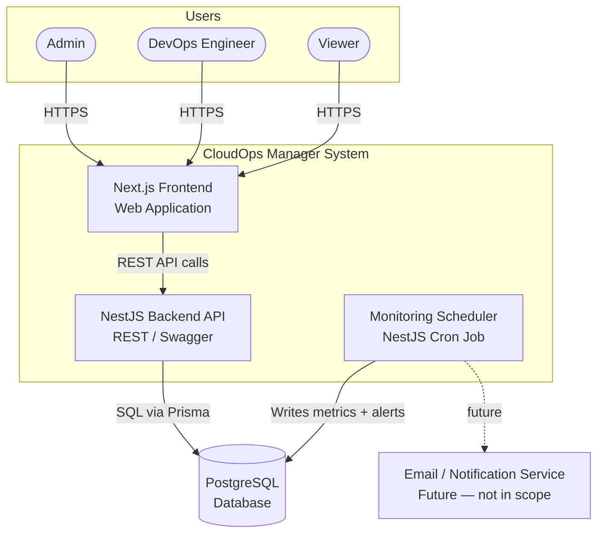
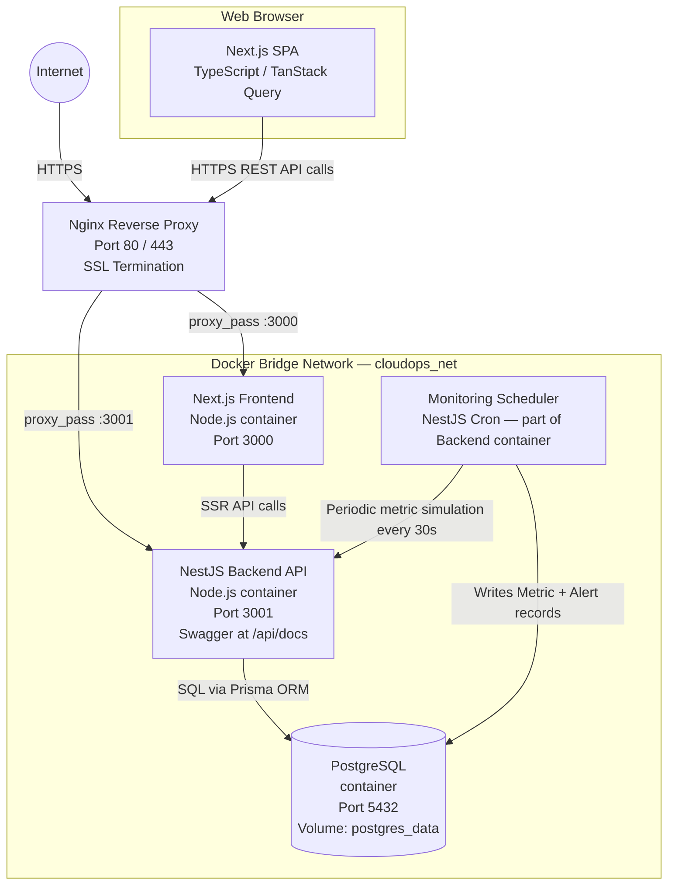

# Architecture Overview

---

## C4 Level 1 — System Context



---

## C4 Level 2 — Container Diagram



---

## Backend Layered Architecture

The NestJS backend follows a strict layered architecture. Each feature domain has its own module with no cross-domain direct dependencies — only dependency injection.

```
NestJS Application
├── AppModule (root)
├── Domain Modules (one per feature)
│   ├── Controller     ← HTTP handlers, DTO binding, route guards
│   ├── Service        ← Business logic, orchestration
│   ├── Repository     ← Prisma calls, query building
│   ├── DTOs           ← create/update/query DTOs with class-validator decorators
│   └── Module         ← DI wiring, imports, exports
│
├── Domain Modules available:
│   ├── AuthModule
│   ├── UsersModule
│   ├── ProjectsModule
│   ├── EnvironmentsModule
│   ├── ServersModule
│   ├── ApplicationsModule
│   ├── MetricsModule
│   ├── AlertRulesModule
│   ├── AlertsModule
│   └── DashboardModule
│
├── Common/
│   ├── Guards
│   │   ├── JwtAuthGuard      ← validates JWT on every non-@Public() route
│   │   └── RolesGuard        ← checks @Roles() decorator against token role claim
│   ├── Decorators
│   │   ├── @Roles(...)       ← attaches required roles metadata to a route
│   │   ├── @Public()         ← marks a route as unauthenticated
│   │   └── @CurrentUser()    ← injects authenticated user from request
│   ├── Filters
│   │   └── GlobalExceptionFilter  ← standardized error response shape
│   ├── Interceptors
│   │   ├── LoggingInterceptor     ← logs method, path, status, duration
│   │   └── TransformInterceptor   ← wraps responses in { data, meta } envelope
│   └── Pipes
│       └── ValidationPipe (global) ← whitelist, forbidNonWhitelisted, transform
│
└── Prisma
    ├── PrismaService   ← singleton Prisma client, onModuleInit connects, onModuleDestroy disconnects
    └── PrismaModule    ← global module, exports PrismaService
```

---

## Frontend Architecture

The Next.js 14 frontend uses the App Router with route groups to separate the authenticated dashboard from the public authentication pages.

```
src/
├── app/
│   ├── layout.tsx                  ← Root layout (fonts, providers)
│   ├── (auth)/                     ← Route group: unauthenticated pages
│   │   └── login/
│   │       └── page.tsx
│   └── (dashboard)/                ← Route group: authenticated pages
│       ├── layout.tsx              ← Dashboard shell: sidebar, header, auth check
│       ├── page.tsx                ← /dashboard — global overview
│       ├── servers/
│       │   ├── page.tsx            ← Server list
│       │   └── [id]/page.tsx       ← Server detail + metrics
│       ├── projects/page.tsx
│       ├── applications/page.tsx
│       └── alerts/page.tsx
│
├── components/
│   ├── ui/                         ← Reusable primitives (Button, Badge, Card, Table)
│   ├── layout/                     ← Sidebar, Header, PageShell
│   ├── servers/                    ← ServerCard, ServerStatusBadge, etc.
│   ├── metrics/                    ← MetricChart, AvailabilityBar
│   └── alerts/                     ← AlertRow, AlertSeverityIcon
│
├── lib/
│   ├── api/
│   │   ├── client.ts               ← Typed fetch wrapper with Bearer token injection + refresh logic
│   │   ├── servers.api.ts
│   │   ├── alerts.api.ts
│   │   └── ...                     ← One file per API module
│   ├── hooks/
│   │   ├── useServers.ts           ← TanStack Query hooks for server data
│   │   ├── useAlerts.ts
│   │   └── ...
│   └── utils/
│       ├── formatDate.ts
│       └── formatBytes.ts
│
├── types/
│   └── api.types.ts                ← TypeScript interfaces mirroring backend response DTOs
│
└── constants/
    └── index.ts                    ← API base URL, pagination defaults, status colors
```

**Loading / error / empty states:** Every data-fetching page uses React Suspense with skeleton loaders, an error boundary component for API failures, and a dedicated `EmptyState` component for empty list responses.
