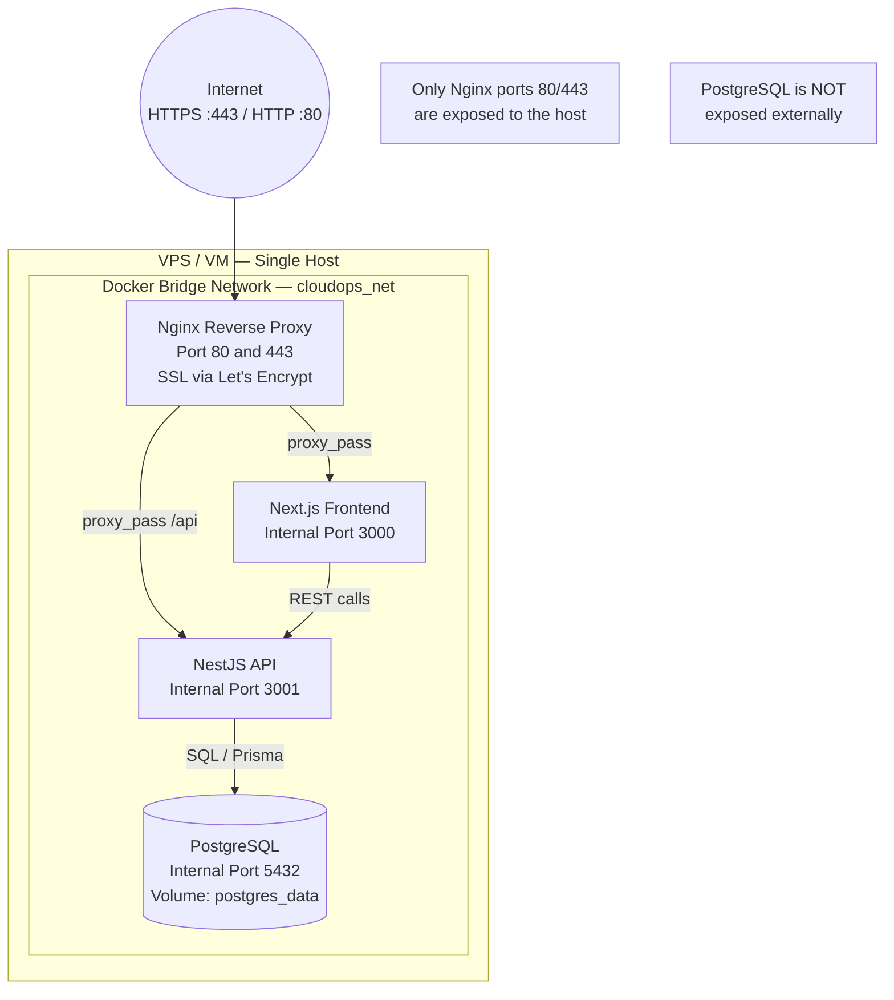

# Deployment Architecture

---

## Target Topology



---

## Environment Strategy

| Environment | Compose Config | Env File | Notes |
|-------------|----------------|----------|-------|
| Development | `docker compose up` with hot-reload volumes | `.env` | Backend uses `nodemon`/`ts-node`; frontend uses Next.js dev server. |
| Staging | `docker compose -f docker-compose.yml -f docker-compose.staging.yml up` | `.env.staging` | Production-like config, staging domain, real DB migrations. |
| Production | `docker compose -f docker-compose.yml -f docker-compose.prod.yml up -d` | `.env.production` | HTTPS enforced, Nginx with Certbot, `restart: always`, no source mount. |

---

## Port Mapping

| Service | Internal Port | External Port | Notes |
|---------|---------------|---------------|-------|
| Nginx | 80, 443 | 80, 443 | Only service with external exposure |
| Next.js Frontend | 3000 | — | Accessed via Nginx proxy only |
| NestJS Backend | 3001 | — | Accessed via Nginx proxy only |
| PostgreSQL | 5432 | — | Internal network only. No external binding. |

---

## Named Volumes

| Volume Name | Purpose | Mounted By |
|-------------|---------|------------|
| `postgres_data` | PostgreSQL data directory persistence | `db` service |
| `certbot_www` | Let's Encrypt ACME challenge files | `nginx` + `certbot` services |
| `certbot_conf` | SSL certificates and Certbot config | `nginx` + `certbot` services |

---

## Network Isolation

All containers communicate over a single Docker bridge network named `cloudops_net`. External traffic enters only through the Nginx reverse proxy. PostgreSQL and the application containers have no externally bound ports, preventing direct access from outside the host.

```
Host Network
    ↓ :80 / :443
  Nginx (cloudops_net)
    ↓ :3000          ↓ :3001
  Frontend          Backend
                      ↓ :5432
                    PostgreSQL
```

---

## SSL / TLS

- **Development:** HTTP only (localhost). No certificate required.
- **Staging / Production:** HTTPS via [Let's Encrypt](https://letsencrypt.org/) with Certbot. The Nginx container handles SSL termination. Certificates are auto-renewed by the Certbot container on a cron schedule.
- HTTP → HTTPS redirect is configured in Nginx for production.

---

## Startup Order

Docker Compose `depends_on` with `condition: service_healthy` ensures startup in this order:

1. **PostgreSQL** — health check: `pg_isready`
2. **NestJS Backend** — health check: `GET /health` returns 200; runs `prisma migrate deploy` on startup
3. **Next.js Frontend** — depends on Backend being healthy
4. **Nginx** — depends on Frontend and Backend

---

> **Note:** Actual Dockerfiles and Compose files are created in Phase 7. This document describes the intended topology and configuration strategy.
