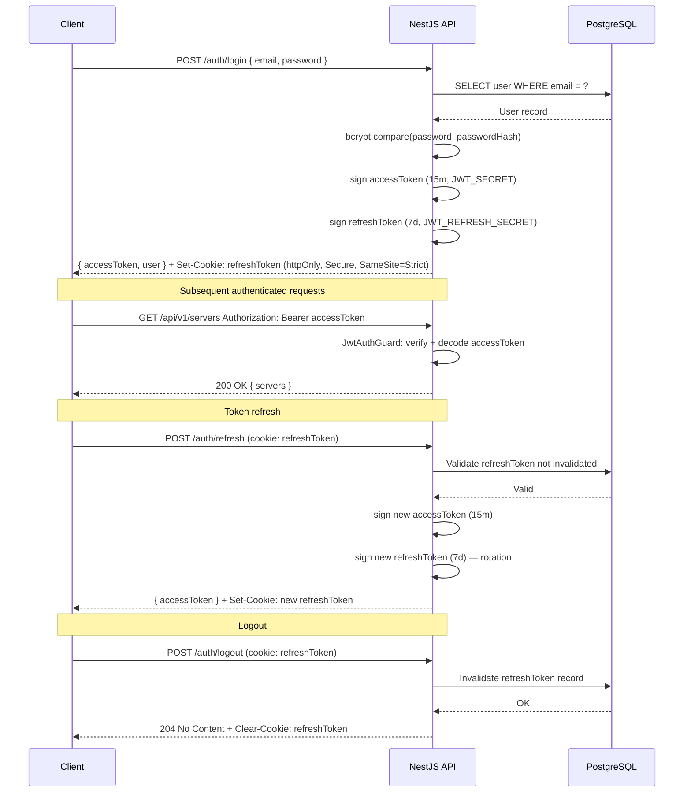

# Security Design

---

## JWT Authentication Flow



---

## Password Hashing

- Algorithm: **bcrypt** with `saltRounds = 12`.
- Hashing occurs in `AuthService.hashPassword()` before any persistence call.
- Comparison uses `bcrypt.compare(plaintext, hash)` — no plaintext is stored, logged, or returned.
- Password fields are never included in API response DTOs. They are excluded at the service layer before returning user objects.

---

## Role-Based Access Control (RBAC)

RBAC is implemented in two NestJS guards applied in sequence on every protected route:

### JwtAuthGuard (global default)
- Applied globally via `APP_GUARD` provider.
- Validates the `Authorization: Bearer <token>` header on every request.
- Routes decorated with `@Public()` bypass this guard.
- On success: injects the decoded token payload (userId, role, email) into `request.user`.
- On failure: throws `UnauthorizedException` (401).

### RolesGuard
- Applied after `JwtAuthGuard`.
- Reads the `@Roles(Role.ADMIN, Role.DEVOPS)` metadata from the route handler.
- Compares `request.user.role` against the allowed roles.
- On failure: throws `ForbiddenException` (403).
- Routes without `@Roles()` metadata are accessible to any authenticated user.

### Role Hierarchy

```
Admin  ⊃  DevOps  ⊃  Viewer
```

Admin can perform every action that DevOps can. The `RolesGuard` checks inclusion in the allowed roles set, so `@Roles(ADMIN, DEVOPS)` grants access to both.

---

## Input Validation

A global `ValidationPipe` is registered in `main.ts` with these options:

```typescript
new ValidationPipe({
  whitelist: true,             // Strip properties not in the DTO
  forbidNonWhitelisted: true,  // Throw on unexpected properties
  transform: true,             // Auto-cast primitives to declared DTO types
  transformOptions: {
    enableImplicitConversion: true,
  },
})
```

All DTOs use `class-validator` decorators (`@IsEmail()`, `@IsString()`, `@IsEnum()`, `@Min()`, etc.). No raw `body` object is ever used in a controller without going through a typed DTO.

---

## CORS Configuration

NestJS CORS is configured in `main.ts`:

```typescript
app.enableCors({
  origin: process.env.NEXT_PUBLIC_API_URL,
  credentials: true,  // Required for httpOnly cookie exchange
  methods: ['GET', 'POST', 'PATCH', 'PUT', 'DELETE', 'OPTIONS'],
  allowedHeaders: ['Authorization', 'Content-Type'],
});
```

All other origins receive a CORS rejection. The `credentials: true` setting is required for the `httpOnly` refresh token cookie to be sent by the browser.

---

## Secrets Management

| Secret | Purpose | Management |
|--------|---------|-----------|
| `JWT_SECRET` | Sign access tokens | Environment variable only |
| `JWT_REFRESH_SECRET` | Sign refresh tokens | Environment variable only |
| `DATABASE_URL` | PostgreSQL connection string | Environment variable only |
| SSL private keys | HTTPS certificate | Mounted as Docker secrets / volume |

Rules:
- `.env` files are listed in `.gitignore` and never committed.
- Only `.env.example` with dummy placeholder values is committed.
- Secrets are never logged. The `LoggingInterceptor` excludes `Authorization` headers and response bodies containing tokens.

---

## Rate Limiting

`@nestjs/throttler` is planned for Phase 3:
- Default limit: **100 requests per minute per IP**.
- Auth endpoints (`/auth/login`, `/auth/refresh`) use a stricter limit: **10 requests per minute per IP**.
- Configuration via environment variables for flexibility.

---

## Security Headers

Nginx is configured with the following response headers in production:

```nginx
add_header Strict-Transport-Security "max-age=31536000; includeSubDomains" always;
add_header X-Content-Type-Options "nosniff" always;
add_header X-Frame-Options "DENY" always;
add_header Referrer-Policy "strict-origin-when-cross-origin" always;
add_header Permissions-Policy "geolocation=(), microphone=()" always;
```
