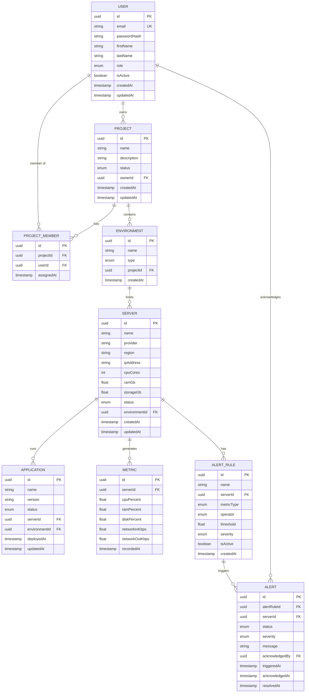

# Entity Relationship Diagram

## Relationship Summary

| Relationship | Cardinality | Description |
|-------------|-------------|-------------|
| USER → PROJECT | 1 : 0..* | A user can own zero or more projects |
| USER → PROJECT_MEMBER | 1 : 0..* | A user can be a member of multiple projects |
| PROJECT → PROJECT_MEMBER | 1 : 0..* | A project can have multiple members |
| PROJECT → ENVIRONMENT | 1 : 1..* | A project must have at least one environment |
| ENVIRONMENT → SERVER | 1 : 0..* | An environment hosts zero or more servers |
| SERVER → APPLICATION | 1 : 0..* | A server runs zero or more applications |
| SERVER → METRIC | 1 : 0..* | A server generates metric records over time |
| SERVER → ALERT_RULE | 1 : 0..* | A server can have multiple alert rules configured |
| ALERT_RULE → ALERT | 1 : 0..* | An alert rule can trigger multiple alerts over its lifetime |
| USER → ALERT | 1 : 0..* | A user can acknowledge zero or more alerts |
